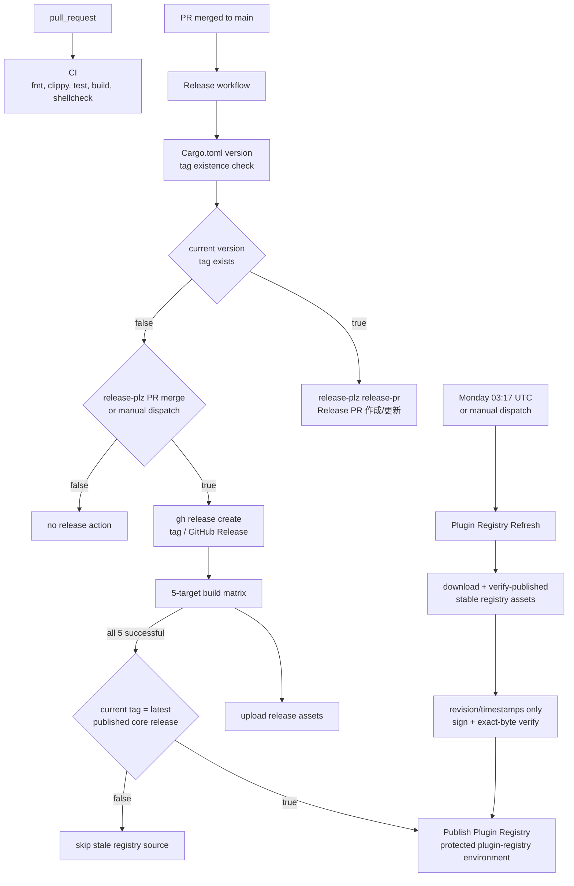

# CI/CD Pipeline

## Overview

GitHub Actions で Rust CLI の検証とリリースを実行する。
Release PR と version bump は [release-plz](https://release-plz.dev/) で自動化し、tag と GitHub Release は workflow 内の `gh release create` で作成する。

## 全体フロー



## CI (`ci.yml`)

**トリガー:** PR 作成・更新時

| Job | 内容 | キャッシュ |
|-----|------|-----------|
| Rust Check | `cargo fmt --check`, `cargo clippy --all-targets`, `cargo test --locked`, `cargo build --release --locked` | cargo registry & build |
| TOML Check | `taplo format --check`, `taplo lint` | なし |
| Script Lint | `scripts/*.sh` の shellcheck | なし |

旧シェル実装と bats テストは削除済み。記事取得・翻訳・保存の検証は Rust ユニットテストで行う。

## Release (`release.yml`)

**トリガー:** `main` への push、または手動実行

通常の feature/fix PR が merge されると `release-plz release-pr` が Release PR を作成または更新する。
Release PR が merge されると workflow が `Cargo.toml` の version から `v0.7.0` 形式の tag を解決し、`gh release create` で tag と GitHub Release を作成する。その後、同じ workflow 内で各プラットフォーム向けバイナリをビルドして asset としてアップロードする。
5 target の build matrix がすべて成功すると、protected `plugin-registry` environment の publisher が署名済み official registry を公開する。build が失敗または skip された場合は publisher を実行しない。build 成功後も、現在の Cargo version tag が draft/prerelease を除く最新の published core release である場合だけ公開し、古い queued run は成功のまま refresh/sign と upload を skip する。

`release-plz.toml` は `git_only = true` にしているため、Release PR の version 判定は crates.io ではなく git tag で行う。workflow は `release-plz release` を実行せず、crates.io publish 経路を通らない。tag 名は release-plz の single-crate default に合わせ、`v0.7.0` のような形式を使う。

| Asset | Target |
|-------|--------|
| `article-collector-linux-amd64` | `x86_64-unknown-linux-gnu` |
| `article-collector-linux-arm64` | `aarch64-unknown-linux-gnu` |
| `article-collector-windows-amd64.exe` | `x86_64-pc-windows-msvc` |
| `article-collector-macos-amd64` | `x86_64-apple-darwin` |
| `article-collector-macos-arm64` | `aarch64-apple-darwin` |

> デフォルト `GITHUB_TOKEN` による Release 作成は別 workflow を起動しないため、GitHub App token での Release 作成と asset build/upload は同一 workflow に置いている。

### セキュリティ

- workflow のデフォルト `GITHUB_TOKEN` は `contents: read` のみ
- GitHub App token の `contents: write` は tag / GitHub Release / asset upload に必要
- GitHub App token の `pull-requests: read` は main commit に対応する Release PR 判定に必要
- GitHub App token の `pull-requests: write` は Release PR 作成・更新に必要
- build は `--locked` で `Cargo.lock` の整合性を検証する
- registry publisher は `needs: build` で 5 target の成功後だけ実行する
- production signing key は deployment branch を `main` に限定した protected
  `plugin-registry` environment の secret からだけ参照する
- publisher は `plugin-registry-publish` concurrency group で直列化し、実行中の
  publish を cancel しない
- concurrency は順序を保証しないため、publisher は厳密な
  `v<major>.<minor>.<patch>` tag を `publishedAt` で比較し、最新 core release
  だけを公開する。対象 release が 0 件、または最大 `publishedAt` が同一の候補が
  複数ある場合は fail-closed とする
- PR CI は public trust set と development fixture だけを検証し、production
  signing key を参照しない

## Plugin Registry Refresh (`plugin-registry-refresh.yml`)

**トリガー:** 毎週月曜 03:17 UTC、または default branch からの手動実行

core release が 30 日以上ない期間も official registry を fresh に保つ。
workflow は stable `plugin-registry-v1` release の公開済み
`plugins-v1.json` / `plugins-v1.sig` だけを download し、expiry を recovery
目的で許容する `verify-published` で schema、trust key、signature を認証する。
repository の registry 内容へ fallback せず、Rust utility が revision を
`u64` として checked increment し、単一の生成時刻から正確に 30 日後の失効時刻
を算出する。その他の payload が意味的に同一であることを確認してから exact
bytes を再署名する。

release publisher と同じ protected `plugin-registry` environment および
`plugin-registry-publish` concurrency group を使い、実行中の publish は
cancel しない。stable release がない、必須 asset が 0 件または欠損・不正、
revision が `u64` でないか increment できない、timestamp が overflow する、
signature が不正、payload preservation または再署名後の検証が失敗した場合は
upload せず fail-closed とする。stable release 自体は作成しない。

手動 recovery では Actions の `Plugin Registry Refresh` を `main` で dispatch
する。実行前の assets を別途保存し、workflow 成功後は空の作業 directory へ
公開後の assets を download して次を実行する。

```bash
mkdir manual-refresh
gh release download plugin-registry-v1 \
  --pattern plugins-v1.json \
  --pattern plugins-v1.sig \
  --dir manual-refresh
cargo run --locked --example plugin_registry -- \
  verify \
  manual-refresh/plugins-v1.json \
  manual-refresh/plugins-v1.sig \
  registry/trusted-keys.json
```

署名と freshness、revision の `+1`、新しい timestamps、および実行前後の JSON
から 3 metadata field を除いた payload の意味的同一性を確認する。

## ワークフローファイル

| ファイル | 用途 |
|---------|------|
| `.github/workflows/ci.yml` | PR CI |
| `.github/workflows/release.yml` | Release PR 作成 + GitHub Release + asset build/upload + protected registry publish |
| `.github/workflows/plugin-registry-refresh.yml` | 週次/手動の protected registry metadata refresh と再署名 |
| `.github/workflows/pr-checklist.yml` | PR checklist 検証 |
| `release-plz.toml` | release-plz の git-only release 設定 |
