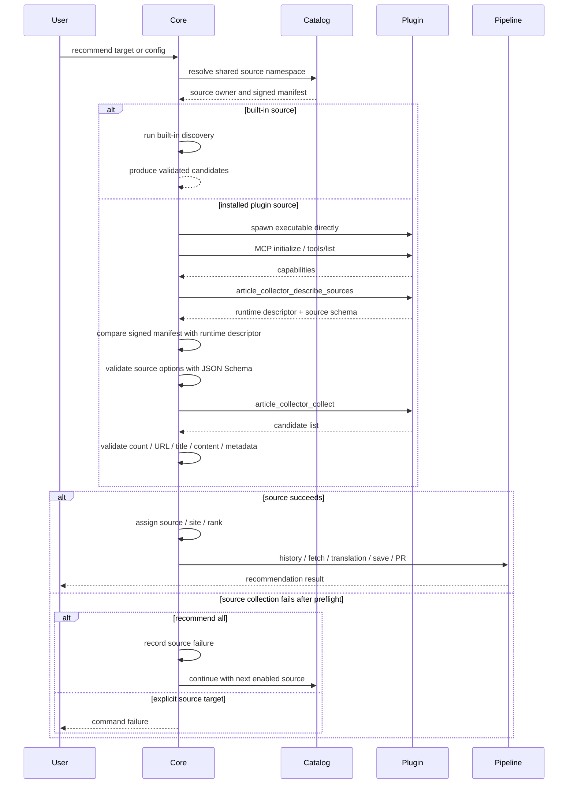

# MCP plugin

この文書は、optional recommendation source plugin の trust boundary、MCP
protocol、local state、運用手順を定義する。現行の production plugin は X
connector であり、core と同じ release workflow から 5 target artifact を配布する。
X plugin の manifest version は release tag から生成し、runtime descriptor の
package version と一致させる。

## 読み方

| 読者 | 主に読む箇所 |
| --- | --- |
| 利用者 | [Plugin 配布](distribution.md)、[recommendation への接続](#recommendation-への接続) |
| plugin 実装者 | [MCP protocol v1](#mcp-protocol-v1)、[trust boundary](#trust-boundary) |
| registry・release 運用者 | [Plugin 配布](distribution.md)、[CI/CD documentation](../ci-cd/README.md) |
| secret を扱う運用者 | [secret.md](secret.md) |

pluginの配布物、registry、install/update、release/refreshの運用は
[Plugin 配布](distribution.md)に分離している。ここでは配布後にcoreがpluginを
起動・検証し、recommendation pipelineへ接続するprotocolとtrust boundaryを定義する。

## recommendation への接続



`[recommend].sources` が未指定なら core内の built-in source registry 順、その後に
installed plugin catalogのsource名順で実行する。明示 list がある場合は built-in と
plugin を混在でき、その順序を保つ。

plugin source の設定は `options` 配下へ隔離する。現行 X plugin の設定例は次の
とおりである。

```toml
[recommend.source.twitter]
limit = 10

[recommend.source.twitter.options]
mode = "search"
query = "(AI OR Rust OR security) lang:en -is:retweet"
```

plugin source は built-in 専用の `query` を拒否し、built-in source は
`options` を拒否する。

## MCP protocol v1

transport とtoolの契約は次のとおりである。

### Transport とtool

| 項目 | 要件 |
| --- | --- |
| transport | stdio上のMCPを使う。 |
| stdout | MCP frame専用。 |
| stderr | 診断用。最大256 KiBまで受け付ける。 |
| `article_collector_describe_sources` | protocol/plugin identity、source名、alias、options JSON Schema、configuration対応有無を返す必須tool。 |
| `article_collector_collect` | canonical source、limit、検証済みoptionsを受け、候補を返す必須tool。 |
| `article_collector_configure` | OAuthなどを行う任意tool。credentialの取り扱いは[secret.md](secret.md)で定義する。 |

### Candidate contract

| 項目 | 要件 |
| --- | --- |
| 候補の必須情報 | `title`、HTTP(S) `url`、`content`を持つ。`metadata`は任意。 |
| 予約metadata | `source`、`site`、`rank`はcoreが管理し、pluginは設定できない。 |
| `rank` | coreがresponse順から付与する。 |
| response全体 | 16 MiB以下。 |
| title | 8 KiB以下。 |
| 各content | 1 MiB以下。 |
| 件数 | requestのlimit以下。 |

### Lifecycleと安全制約

| 処理 | 制限・動作 |
| --- | --- |
| startup | initialize request、initialized notification、`tools/list`を含めて10秒でtimeoutする。 |
| collect | 60秒でtimeoutする。 |
| configure | 300秒でtimeoutする。 |
| graceful shutdown | 5秒でtimeoutする。 |
| process group | 専用process groupで起動する。WindowsではJob Objectを使う。timeout、startup failure、graceful shutdown timeout時は同じgroupのdescendantも終了し、異常終了時はbounded diagnosticを返す。 |
| 環境変数 | signed manifestで許可された環境変数だけをchildへ渡す。WindowsではOS起動に必要な`SystemRoot`を例外として追加する。redaction規則は[secret.md](secret.md)で定義する。 |
| JSON-RPC error | `data`をcoreのerror/logへ転記しない。 |

## trust boundary

trust boundaryの保証範囲と制約を次のように分ける。

| 対象 | 保証すること | 保証しないこと |
| --- | --- | --- |
| official registry | publisher identity、manifest、配布物の署名と完全性を検証する。 | pluginの動作が無害であること。 |
| plugin process | coreとは別processとしてMCP stdioで起動する。 | 完全なOS sandbox。実行ユーザーと同じOS権限を持つ。 |
| 環境変数 | signed manifestで許可された環境変数だけをchildへ渡す。 | filesystemやnetworkのOS-level capabilityを取り消すこと。 |
| executable path | plugin data root配下のregular fileに限定し、absolute path、`..`、symlink/reparse pointを拒否する。 | 同一ユーザーの別processによるdata root改変。 |
| process起動 | shellを介さずargument vectorで直接起動し、canonical pathのcontainmentを起動時にも再確認する。 | hostile processに対する完全なfilesystem isolation。 |

```text
[Official registry] -- verified artifact --> [Core]
[Core] <------- MCP request / response ----> [Plugin process]
[User] -- same OS permissions -----------> [Core]
[User] -- same OS permissions -----------> [Plugin process]
[Core] ----------------------------------> [Host resources]
[Plugin process] ------------------------> [Host resources]
```

registryからcoreへ渡るのは検証済みartifactだけである。coreとpluginはMCP stdioで通信し、
どちらも実行ユーザーと同じOS権限でhost resourcesへアクセスする。

同一ユーザー権限のhostile processまで隔離するには、将来のOS sandboxと
handle-relative/no-follow storage APIが必要である。

## local state

OS user data directory は次を基準にする。

| OS | 既定 root |
| --- | --- |
| Linux | `${XDG_DATA_HOME:-$HOME/.local/share}/article-collector` |
| macOS | `~/Library/Application Support/article-collector` |
| Windows | `%LOCALAPPDATA%\article-collector` |

```text
<data-root>/
  registry/
    state.json
  plugins/
    <plugin-name>/
      installed.json
      <version>/
        plugin.toml
        plugin[.exe]
```

| path | 役割 |
| --- | --- |
| `registry/state.json` | 最後に受理したregistry revisionを原子的に記録する。rollbackを拒否する。 |
| `plugins/<plugin-name>/installed.json` | pluginのactive versionを原子的に切り替えるための状態を持つ。 |
| `plugins/<plugin-name>/<version>/plugin.toml` | インストール済みversionのmanifestを保存する。 |
| `plugins/<plugin-name>/<version>/plugin[.exe]` | 検証済みの実行ファイルを保存する。 |

```text
install / update
  -> Staging
  -> Verified (download, byte length/SHA-256, MCP probe)
  -> Active (version と installed.json を atomic switch)

Staging -- 検証失敗 --> Failed
  (active は変更しない)

Staging -- crash --> Stale
  (doctor が報告。active は変更しない)

Active -- update --> Staging
```

source catalogはsigned installed manifestだけから構築し、executableの存在確認は
実行直前まで遅延する。欠損executableは該当plugin sourceだけのfailureとなり、
`recommend all`では無関係なbuilt-in sourceを停止しない。

図の最後の分岐は、source planの事前検証が成功した後のcollection/runtime failureを
表す。unknown source、plugin optionsのJSON Schema違反、built-in/plugin namespaceの
衝突などのpreflight errorは、`recommend all`でもcommand failureとして返す。

## 配布・運用ドキュメント

registry payload、署名、release順序、独立refresh、production smoke test、cleanupの
規則は [Plugin 配布](distribution.md) に分離している。workflowの権限とjobの詳細は
[CI/CD documentation](../ci-cd/README.md)を参照する。
