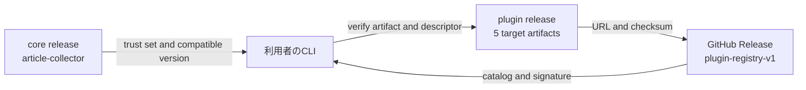
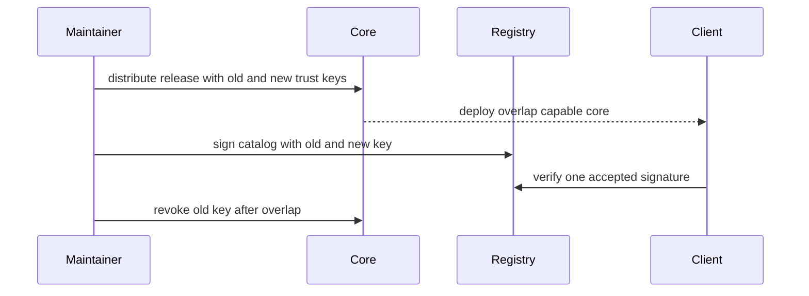
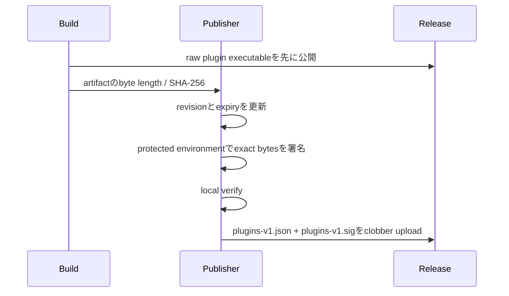
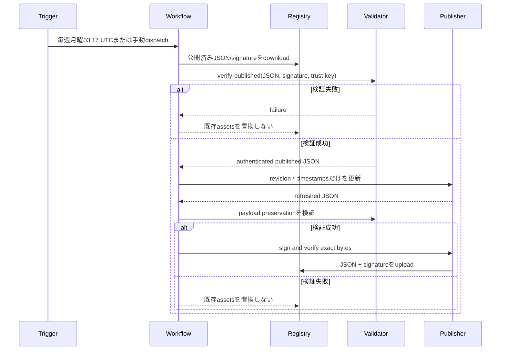

# Plugin 配布

この文書は、plugin を利用者へ配布するための registry、release、refresh、
install/update の契約を定義する。MCP protocol、runtime、trust boundary の仕様は
[MCP plugin](README.md) を参照し、secret の値と redaction は
[secret.md](secret.md) を参照する。

## 読み方

| 読者 | 主に読む箇所 |
| --- | --- |
| 利用者 | [install / update](#install--update)、[registryの状態](#registryの状態) |
| plugin 開発者 | [registry payload](#registry-payloadと検証)、[release順序](#release順序) |
| release 運用者 | [refresh](#independent-refresh)、[production smoke test](#production-smoke-test) |

## 配布物の関係



core と plugin artifact は同じ release tag で配布する。plugin manifest version は
tag から生成し、runtime descriptor の package version と一致させる。registry の
JSONと署名は、plugin artifactを先にGitHub Releaseへ公開した後に生成する。

## registryの状態

repository 内の `registry/` は PR/CI と release publisher の入力に使う development
fixture であり、利用者が取得する production registry の現在状態ではない。

| ファイル | 管理場所 | 分類 | 用途 |
| --- | --- | --- | --- |
| `registry/plugins-v1.json` | リポジトリ | 開発fixture | schemaを検証する空の入力。production registryの現在状態は表さない。 |
| `registry/x-plugin-manifest.json` | リポジトリ | 生成template | release時にversion、artifact URL、byte length、SHA-256を生成する基礎情報。 |
| `registry/trusted-keys.json` | リポジトリ | 署名検証用trust root | production registryの署名を検証する公開鍵。plugin一覧のtemplateではない。 |
| `plugin-registry-v1/plugins-v1.json` | GitHub Releaseのみ | 本番catalog | CLIがinstall可能なpluginとartifact情報を取得するcatalog。 |
| `plugin-registry-v1/plugins-v1.sig` | GitHub Releaseのみ | 本番catalogの署名 | catalogのexact bytesを検証する署名。 |

production registryのJSONと署名は、5 targetのplugin artifactを先に公開した後、
release workflowまたは独立したrefresh workflowが生成・検証・署名してGitHub Releaseへ
uploadする。repository内のfixtureを直接編集してproduction状態を表すものではない。

## install / update

```bash
article-collector plugin install x
article-collector plugin install x@<release-version>
article-collector plugin list
article-collector plugin update x
article-collector plugin configure x
article-collector plugin doctor x
article-collector plugin uninstall x
```

`install` / `update` は binary に埋め込まれた trust set と official registry URL だけを
使う。registry URL override、local executable install、third-party registry は protocol
v1の対象外である。productionの `plugin-registry-v1` には現在 `x` pluginが登録されて
おり、署名、checksum、MCP descriptorを検証してから導入する。

`uninstall` は指定した plugin の directory だけを削除する。アプリケーションからは
復元できないため、必要になった場合は registry から再 install する。

## registry payloadと検証

| 項目 | 要件 |
| --- | --- |
| schema | schema v1。revision、生成/失効時刻、plugin versions、protocol compatibility、manifest、5 targetのartifact情報を持つ。 |
| artifact情報 | URL、byte length、SHA-256を持つ。registryとartifactの全redirect hopはHTTPSに限定する。 |
| options | clientがoptions JSON Schemaをcompile validationする。 |
| 署名対象 | `plugins-v1.json`のexact bytes。JSONを再serializeした結果ではない。 |
| 署名方式 | Ed25519。 |
| key ID | public key bytesのSHA-256を`ed25519-sha256:<lowercase-hex>`で表す。 |

### key rotation（将来設計）

現行の signer は single-key envelope を要求し、複数 signature を検出した場合は
fail-closed で既存の stable asset を置換しない。次の図は、full multi-key overlap
対応時に想定する rotation の順序である。



## release順序



| publisherの規則 | 動作 |
| --- | --- |
| 入力 | 初回publishはrepositoryの空fixtureを基礎にし、既存のproduction registryがある場合はJSON/signatureをdownloadして検証する。refreshは常に既存production assetを入力にし、fixtureへfallbackしない。 |
| revision | `max(source revision, published revision) + 1`を採番し、同じsource checkoutでも再利用しない。 |
| recovery | publisher専用検証は真正性とschema/semanticを要求するがfreshnessは要求しない。失効後もrevisionとexpiryを更新して復旧できる。 |
| concurrency | publish jobは`plugin-registry-publish` concurrency groupで直列化する。 |

## independent refresh

core releaseがない期間も、official registryを週次でfreshに保つ。refreshは公開済みで
署名検証済みのregistry assetだけを入力にし、revisionとtimestamps以外のplugin payloadを
変更しない。



| 項目 | 規則 |
| --- | --- |
| 実行契機 | 毎週月曜03:17 UTCまたは手動dispatch。 |
| 入力 | stable `plugin-registry-v1` releaseから取得した公開済みJSON/signatureだけを使う。repositoryのfixtureは参照しない。 |
| `verify-published` | recoveryのためexpiryだけを許容し、schema、trust key、signatureは通常どおり検証する。 |
| signature envelope | 現行signerはexactly one signatureを要求する。複数signatureはmetadata変換前にfail-closedとする。full multi-key signingは[#92](https://github.com/rurusasu/article-collector/issues/92)で追跡する。 |
| metadata | Rust publisher utilityがrevisionを`u64`としてchecked incrementし、`generated_at`から30日後の`expires_at`を算出する。overflowはfail-closed。 |
| payload | `revision`、`generated_at`、`expires_at`以外は意味的に変更しない。 |
| 同時実行 | protected `plugin-registry` environmentと`plugin-registry-publish` concurrency groupを共有し、実行中のpublisherをcancelしない。 |
| 失敗時 | stable releaseが0件、必須assetの欠損/不正、revisionの不正/overflow、timestamp overflow、署名検証失敗、複数signatureの場合はrelease作成・repository fallback・asset置換を行わない。 |

## release sourceの選択

| 条件 | 動作 |
| --- | --- |
| PR CI | schemaとdevelopment fixture signatureだけを検証し、production private keyを参照しない。 |
| build条件 | 5 targetのcore buildがすべて成功した後だけproduction publisherを実行する。 |
| 対象tag | Cargo metadataからtagを導出し、draft/prereleaseではない厳密な`v<major>.<minor>.<patch>` releaseだけを`publishedAt`で比較する。 |
| 最新tag | 現在のtagが最新の場合だけrefresh/sign/uploadを実行する。 |
| queued run | 古いqueued runは成功のままrefresh/sign/uploadをskipする。 |
| 曖昧な状態 | 対象releaseが0件、または最大`publishedAt`のreleaseが複数の場合は入力順で選ばずfailする。 |

## production smoke test

| 確認項目 | 合格条件 |
| --- | --- |
| 署名 | 公開済みJSON/signatureの検証に成功する。 |
| freshness | registryがfreshである。 |
| revision | revisionが単調増加している。 |
| artifact | 公開済みplugin artifactのchecksumが一致する。 |
| 現行状態 | X pluginの5 target artifactを含む。空のregistryはPR用checked-in fixtureだけに存在する。 |

## 保守とcleanup

| 変更・作業 | ルール |
| --- | --- |
| protocol/schema変更 | 後方互換を暗黙に仮定せずversionを上げる。 |
| plugin release | registryより先にartifactを公開する。 |
| stale `.staging-*` | `doctor`で対象を確認してからexact plugin directory内でcleanupする。 |
| 新しいplugin | 5 target artifact、manifest、checksum、signed registry entryの順で更新し、production installのsmoke testを記録する。 |

詳細なworkflowの権限、job、手動recoveryコマンドは
[CI/CD documentation](../ci-cd/README.md)を参照する。
